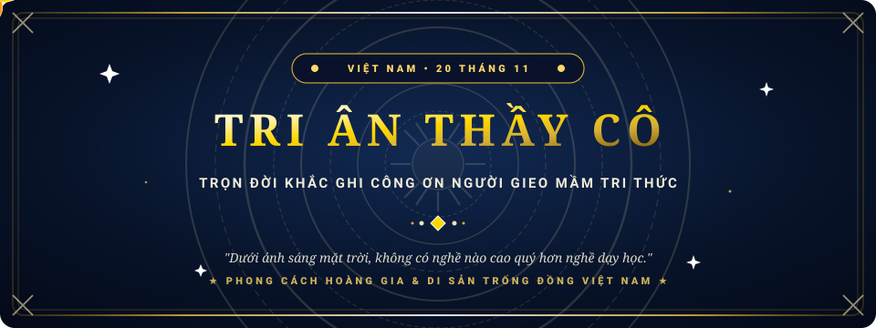
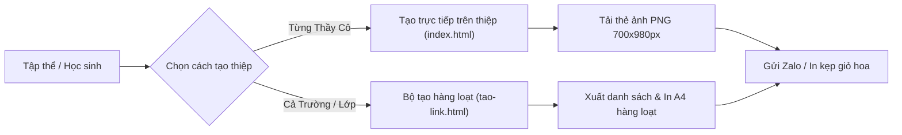

<p align="center">
  <a href="https://phanleon.github.io/20-11/">
    
  </a>
</p>

<p align="center">
  <a href="https://phanleon.github.io/20-11/">
    
  </a>
  <a href="#-điểm-nổi-bật-về-công-nghệ--nghệ-thuật">
    
  </a>
  <a href="#-hệ-thống-canvas-2d--hạt-hạt-chuyển-động">
    
  </a>
  <a href="#-âm-nhạc-du-dương--tương-tác-âm-thanh">
    
  </a>
  <a href="#-kiến-trúc-zero-build-thuần-khiết">
    
  </a>
</p>

<div align="center">

### 🌟 [Trải Nghiệm Thiệp Trực Tuyến](https://phanleon.github.io/20-11/) • 🖨️ [Tạo Thẻ QR & In Hàng Loạt](https://phanleon.github.io/20-11/tao-link.html) • 💌 [Cá Nhân Hóa Link Tri Ân](#-hướng-dẫn-cá-nhân-hóa-lời-chúc-qua-url) • 📜 [Sổ Lưu Bút Tri Ân](#-sổ-lưu-bút-tri-ân-thầy-cô)

</div>

---

<p align="center">
  <a href="https://phanleon.github.io/20-11/">
    
  </a>
  <br>
  <em>Hành trình 5 cảnh ký ức thầy trò: Cắp sách đến trường • Bàn tay dắt lối • Hoạt động vui tươi • Thành tài vinh danh • Bó hoa tri ân</em>
</p>

---

## 🕊️ Ý Tưởng Thiết Kế & Di Sản Dân Tộc

> [!IMPORTANT]
> **Thiệp Điện Tử 20/11** không chỉ là một trang web thiệp mừng thông thường, mà là một **tác phẩm nghệ thuật số tương tác cao cấp**, lấy cảm hứng từ đạo lý ngàn đời của người Việt: *"Tôn sư trọng đạo – Uống nước nhớ nguồn"*.

Sự kết hợp hài hòa giữa **Phong cách Hoàng Gia (Royal Navy & Champagne Gold)** và **Di sản Văn hóa Việt Nam**:

| Biểu Tượng | Ý Nghĩa Văn Hóa & Nghệ Thuật |
| :--- | :--- |
| **🌌 Royal Navy & Champagne Gold** | Sắc xanh biển sâu đại diện cho bầu trời đêm tri thức bao la; ánh vàng sâm-panh tượng trưng cho ngọn đèn soi đường của người thầy. |
| **🥁 Trống Đồng Đông Sơn** | Mặt trời 12 tia sáng và chim Lạc xoay chậm chìm ở nền thiệp, gợi nhớ cội nguồn dân tộc và dòng chảy tri thức bền bỉ qua ngàn năm. |
| **🦅 Đàn Chim Én Vàng (Canvas 2D)** | Cánh én chao liệng mang mùa xuân tri thức, nâng cánh cho bao ước mơ của thế hệ học trò bay cao, bay xa. |
| **🪔 Đèn Hoa Đăng Tri Ân** | Những đóa sen vàng chở theo lời chúc của học sinh, đồng bộ bay lên bầu trời đêm lung linh huyền ảo. |
| **✉️ Ấn Sáp Dập Nổi 3D** | Chạm nhẹ mở nắp phong bì, như mở ra bức thư tay chứa chan tình cảm gửi người lái đò thầm lặng. |

---

## ✨ Điểm Nổi Bật Về Công Nghệ & Trải Nghiệm Người Dùng

### 1. 🦅 Hiệu Ứng Đàn Chim Én Vàng Chao Liệng (Mới)
- **Tạo hình Bezier chính xác**: Đôi cánh trăng khuyết vuốt nhọn quét về phía sau, thân mình thuôn dài và **đuôi chẻ chữ V** đặc trưng của loài chim én.
- **Chuyển động sinh học chân thực**: Tự động luân phiên giữa **đập cánh dồn dập** và **chao liệng lướt gió** (*gliding*), có độ dập dềnh sóng tự nhiên theo từng cá thể trong đàn.
- **Vệt bụi vàng kim tuyến (Stardust Wake)**: Từng chú chim để lại dải hạt bụi vàng li ti tan biến dần trên nền trời.
- **Kích hoạt linh hoạt**: Tự động cất cánh sau khi mở trang (2.4s), lặp lại định kỳ mỗi 24s, hoặc vút bay rực rỡ khi nhấn vào ấn sáp mở thiệp và ở màn kết.

### 2. ✉️ Phong Bì Hoàng Gia & Dấu Ấn Sáp 3D Phát Sáng
- Dấu sáp hoàng gia dập nổi họa tiết hoa sen vàng với hiệu ứng nhịp thở phát sáng (*seal pulse*).
- Thao tác một chạm mở nắp phong bì theo không gian 3D, kích hoạt pháo hoa bụi vàng và bắt đầu khúc nhạc tri ân.
- Hiệu ứng **Fly-In Memory Montage**: các bức tranh ký ức bay từ 4 phía màn hình hội tụ vào tâm trước khi mở ra thiệp chính.

### 3. 🎞️ Slide Điện Ảnh 20 Bức Tranh Ký Ức Thầy Trò
- Bộ 20 tranh minh họa nghệ thuật nét vẽ truyền cảm xúc: từ ngày đầu ngây thơ cắp sách đến trường, thầy cô ân cần cầm tay dắt vào lớp, những giờ học sôi nổi đến ngày học trò thành tài đoạt cúp vàng vinh quang và ôm trọn người thầy trong niềm xúc động.
- **6 hiệu ứng chuyển cảnh luân phiên**: Mờ dần (*fade*), Trượt ngang (*slide*), Mở vòng tròn (*iris circle*), Zoom nhòe điện ảnh (*zoom blur*), Quét dọc rèm lụa (*wipe*), Xoay nhẹ (*rotate*).
- Tích hợp hiệu ứng chuyển động chậm Ken Burns, thanh đếm thời gian tiến trình, nút điều khiển và vuốt chạm cảm ứng mượt mà trên điện thoại.

### 4. 🪔 Bầu Trời Đèn Hoa Đăng Tri Ân (Realtime Cloud Sync)
- Người dùng có thể viết lời chúc riêng và tên của mình để thả một chiếc đèn hoa đăng bay lên bầu trời.
- Đèn hoa đăng mang theo ngọn nến lung linh và dải lụa ghi lời chúc trang trọng.
- **Lưu bút vĩnh viễn**: Mọi lời chúc được lưu giữ trong **Sổ Lưu Bút Tri Ân**, hiển thị số lượng đèn đã thả trên thanh tiêu đề và màn kết.

### 5. 🎆 Mưa Cánh Sen & Pháo Hoa Bụi Vàng (Canvas 60 FPS)
- Ba lớp hạt chuyển động không phụ thuộc thư viện ngoài:
  1. **Bụi vàng lơ lửng** (*ambient gold dust*).
  2. **Vệt sao bụi vàng theo con trỏ chuột/chạm tay** (*interactive stardust trail*).
  3. **Pháo hoa bung nở hoàng gia** (*sparkling fireworks*).
  4. **Mưa cánh hoa sen vàng chao liệng trong gió** (*lotus petal rain*).

### 6. 🎵 Âm Nhạc Du Dương
- Nhạc nền MP3 bài hát **"Người Gieo Mầm Xanh"** (Hứa Kim Tuyền x Hoàng Dũng) phát du dương khi mở thiệp, có thanh điều khiển âm lượng và nút bật/tắt tiện lợi.
- Hiệu ứng âm thanh tinh xảo (tiếng chuông lấp lánh khi mở dấu sáp, tiếng thả đèn) được tạo bằng **Web Audio API** tích hợp sẵn.

---

## 🖨️ Tạo Mã QR & Thẻ Thiệp Riêng Cho Từng Thầy Cô

Dự án cung cấp **2 giải pháp tiện lợi** để bạn gửi tặng thầy cô:



### Cách 1: Tạo trực tiếp trên trang thiệp (`index.html`)
1. Bấm vào biểu tượng **Cây Bút Chỉnh Sửa** ✏️ ở góc trên bên phải màn hình.
2. Nhập:
   - **Tên Thầy/Cô**: Ví dụ `Thầy Nguyễn Văn An`
   - **Người gửi**: Ví dụ `Tập thể Lớp 12A1`
   - **Lời chúc từ trái tim**: Lời nhắn gửi riêng cho thầy cô.
3. Bấm **"Tạo & Tải Mã QR Riêng Cho Thầy/Cô Này"**:
   - Hệ thống tự sinh mã QR sắc nét và khung thẻ thiệp sang trọng.
   - Bấm nút tải để lưu ngay file ảnh **Thẻ Thiệp Tri Ân PNG (700x980px)** gửi qua Zalo/Facebook hoặc in màu.

### Cách 2: Tạo hàng loạt cho cả trường hoặc khối lớp (`tao-link.html`)
1. Mở file [tao-link.html](tao-link.html) trên trình duyệt (hoặc truy cập trực tuyến [tại đây](https://phanleon.github.io/20-11/tao-link.html)).
2. Dán danh sách tên Thầy Cô (mỗi dòng một người, hỗ trợ định dạng `Tên Thầy Cô | Lời chúc riêng`).
3. Bấm **"Tạo Danh Sách & Mã QR"** – hệ thống sẽ tức thì tạo hàng chục hoặc hàng trăm thẻ QR.
4. **Các tính năng xuất tiện lợi**:
   - 🖨️ **In toàn bộ thẻ QR**: Định dạng chuẩn trang A4 (căn đều 6–8 thẻ/trang) để cắt kẹp giỏ hoa.
   - 📥 **Tải toàn bộ thẻ ảnh PNG**: Lưu ảnh thẻ từng thầy cô về máy.
   - 📋 **Sao chép toàn bộ đường link**: Dễ dàng gửi cho ban cán sự lớp hoặc ban đại diện phụ huynh.

---

## 💌 Hướng Dẫn Cá Nhân Hóa Lời Chúc Qua URL

Bạn có thể tạo nhanh liên kết thiệp mang thông điệp riêng bằng cách thêm tham số vào URL:

| Tham Số | Ý Nghĩa | Ví Dụ |
| :--- | :--- | :--- |
| `to` | Tên Thầy Cô hoặc Quý Thầy Cô nhận thiệp | `to=Thầy%20Nguyễn%20Văn%20A` |
| `from` | Tên người gửi, nhóm hoặc tập thể học trò | `from=Tập%20thể%20Lớp%2012A1` |
| `msg` | Lời nhắn gửi riêng (tối đa 280 ký tự, có hiệu ứng gõ chữ) | `msg=Kính%20chúc%20Thầy%20luôn%20mạnh%20khỏe` |

### Ví dụ liên kết hoàn chỉnh:
```text
https://phanleon.github.io/20-11/?to=Thầy%20Hiệu%20Trưởng&from=Cựu%20Học%20Sinh%20Khóa%202020&msg=Tri%20ân%20Người%20thầy%20kính%20yêu%20đã%20luôn%20chắp%20cánh%20cho%20ước%20mơ%20chúng%20em!
```

> [!TIP]
> **Mẹo:** Các ký tự tiếng Việt có dấu và khoảng trắng sẽ được trình duyệt tự động mã hóa URL khi bạn sao chép qua bảng chỉnh sửa trên web!

---

## 📱 Quét Mã QR Truy Cập Nhanh

<p align="center">
  
  <br>
  <em>Dùng camera điện thoại hoặc Zalo quét mã để mở thiệp ngay lập tức</em>
</p>

---

## 📂 Cấu Trúc Mã Nguồn

```text
20-11/
├── index.html                  # 🌟 Toàn bộ giao diện thiệp, Canvas FX Engine & Web Audio
├── tao-link.html               # 🖨️ Công cụ tạo thẻ QR & in kẹp hoa hàng loạt cho trường/lớp
├── generate_qr.py              # 🐍 Script Python hỗ trợ tạo mã QR độ nét cao
├── qr_20_11.png                # 📱 Ảnh mã QR trỏ về trang chủ GitHub Pages
├── HUONG_DAN_FIREBASE.md       # 📖 Hướng dẫn cấu hình Firebase Realtime Database
├── README.md                   # 📘 Tài liệu dự án chi tiết & hướng dẫn sử dụng
└── assets/
    ├── banner_animated.svg     # 🎨 Banner vector động Trống Đồng & Đàn Én Vàng
    ├── preview_demo.gif        # 🎞️ Ảnh động demo 5 cảnh ký ức thầy trò
    ├── nguoi-gieo-mam-xanh.mp3 # 🎵 Nhạc nền "Người Gieo Mầm Xanh"
    ├── qrcode.min.js           # ⚙️ Thư viện tạo mã QR offline (không cần mạng)
    ├── tribute_video.mp4       # 🎬 Video hoạt hình kỷ niệm thầy trò
    └── *.webp / *.jpg          # 🖼️ Bộ 20 tranh minh họa nghệ thuật tối ưu hóa
```

---

## 🛠️ Công Nghệ & Hiệu Suất

- **HTML5 & Vanilla JavaScript ES6+**: Hoàn toàn không dùng framework nặng, tải trang trong chớp mắt.
- **Canvas 2D Graphics Engine**: Xử lý 60 FPS mượt mà cho 7 hệ thống hiệu ứng hạt: bụi vàng, vệt sao chuột, pháo hoa, cánh sen, đèn hoa đăng, đàn én vàng và vệt kim tuyến.
- **Tailwind CSS CDN**: Thiết kế responsive tối ưu cho mọi kích thước màn hình từ điện thoại thông minh, máy tính bảng đến màn hình máy tính 4K.
- **Web Audio API**: Bộ tổng hợp âm thanh chuông ngân và giai điệu tương tác không độ trễ.
- **WebP Image Format**: Toàn bộ tranh minh họa được nén chuẩn WebP chất lượng cao, dung lượng nhẹ giúp xem mượt trên 3G/4G.

---

## 🚀 Hướng Dẫn Cài Đặt & Triển Khai

### Xem trực tiếp trên máy tính:
Không cần cài đặt Node.js hay bundler. Bạn chỉ cần mở tệp `index.html` bằng bất kỳ trình duyệt web nào (Chrome, Safari, Edge, Firefox).

### Triển khai lên GitHub Pages:
1. Đẩy mã nguồn lên repository GitHub của bạn (`git push origin main`).
2. Truy cập **Settings** > **Pages** trên giao diện GitHub.
3. Tại mục **Build and deployment > Source**, chọn **Deploy from a branch**.
4. Chọn branch **`main`**, thư mục **`/ (root)`**, sau đó bấm **Save**.
5. Trang web sẽ sẵn sàng sau 1–2 phút tại địa chỉ: `https://<ten-user>.github.io/<ten-repo>/`.

---

<p align="center">
  
</p>

<p align="center">
  <strong>KÍNH CHÚC QUÝ THẦY CÔ GIÁO LUÔN TRÀN ĐẦY SỨC KHỎE, HẠNH PHÚC</strong><br>
  <em>Và luôn giữ vững ngọn lửa nhiệt huyết vì sự nghiệp trăm năm trồng người!</em>
</p>

<p align="center">
  <sub>Phát triển với tất cả lòng kính trọng và tri ân nhân ngày Nhà Giáo Việt Nam 20/11 • 2026</sub>
</p>
